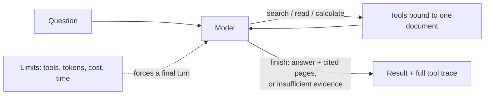
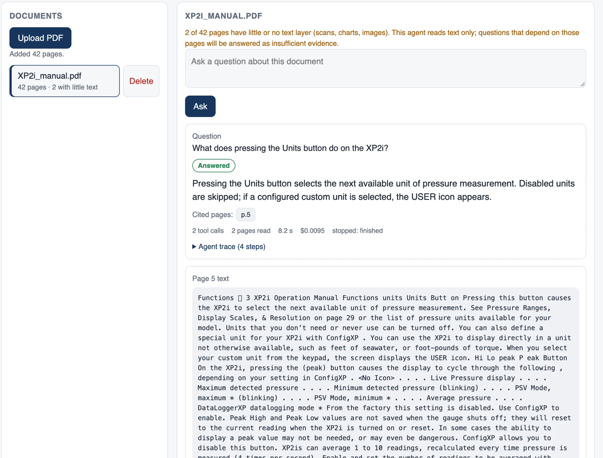
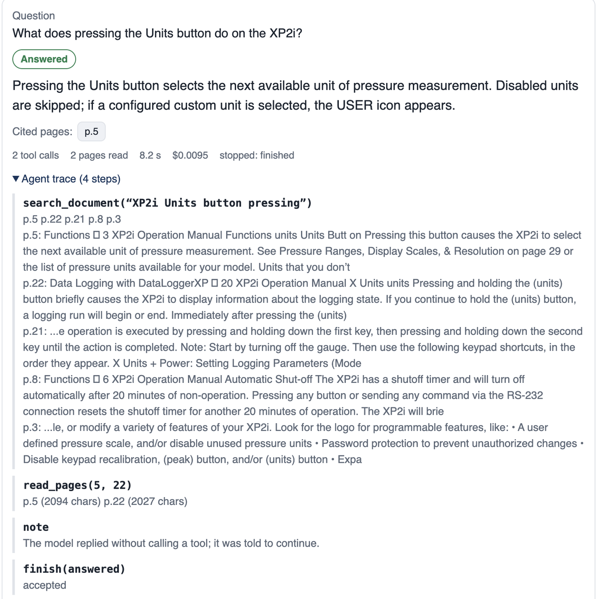
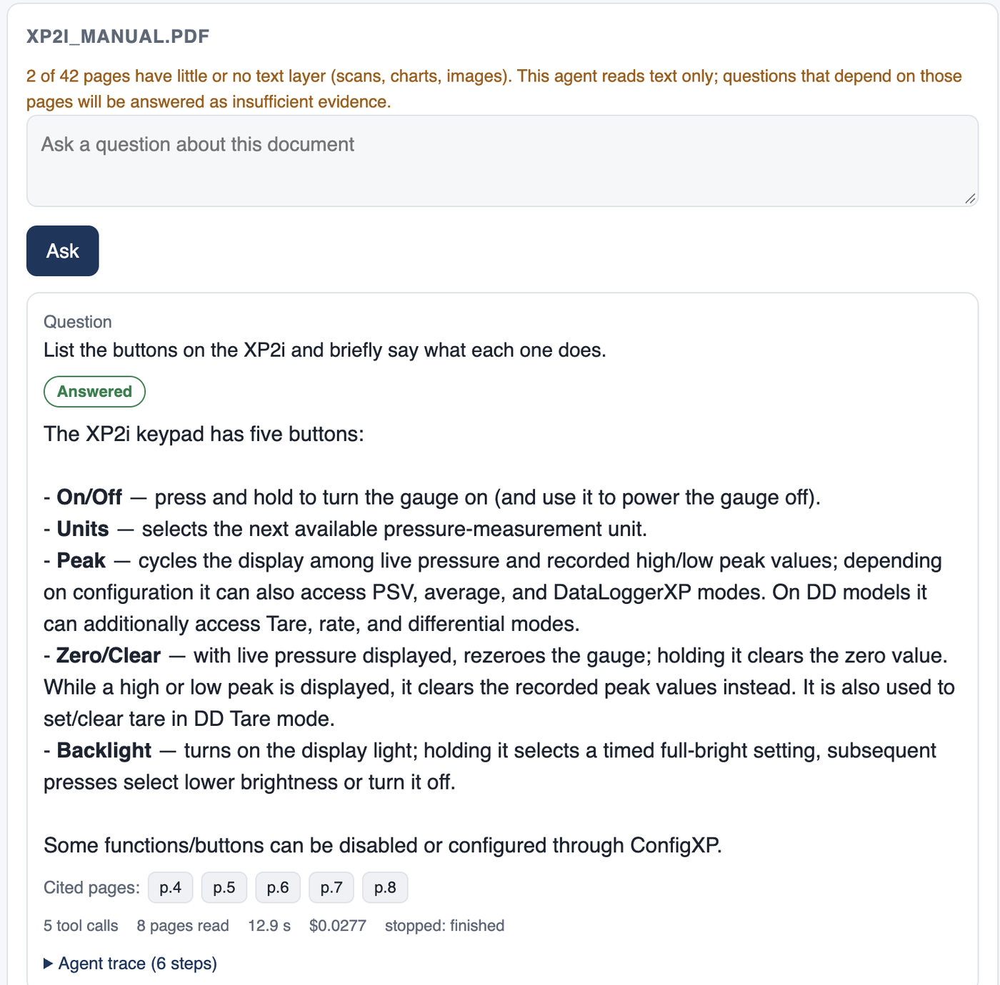
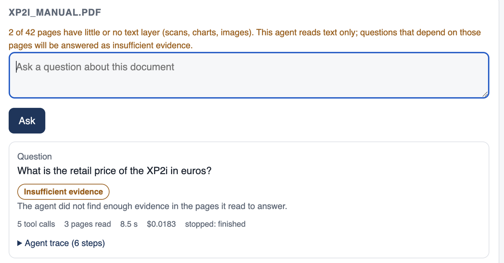
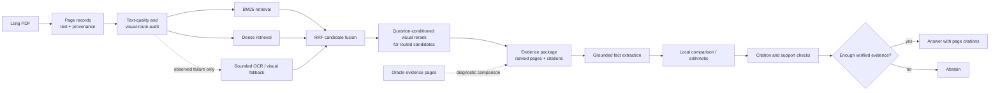

# Evidence-Grounded Document Intelligence

[English](README.md) | [简体中文](README.zh-CN.md)

[](https://github.com/XinXie70/evidence-grounded-document-intelligence/actions/workflows/tests.yml)

A reproducible research system for answering questions over long PDFs **with page-level evidence and an explicit option to abstain**.

**Version status:** **V1** (retrieve-then-answer, locked-test evaluated) and **V2** (a search-and-read
agent compared with fixed pipelines, evaluated once on held-out documents after a code freeze) are both
complete. V2 results are reported in [`experiments/V2_FINAL_REPORT.md`](experiments/V2_FINAL_REPORT.md);
the plan, rules and progress log are in [`V2_PLAN.md`](V2_PLAN.md) (Chinese).

## At a glance

- **V2, held-out evaluation (103 documents, 370 questions, run once after freezing the code):** on
  questions that need several pages, the search-and-read agent reaches **72.4% task accuracy vs 28.1%
  for a one-shot 3-page pipeline** (+44.3 points, 95% CI [36.3, 52.4]) and 41.9% for a one-shot 6-page
  pipeline. The gain comes from reading the right pages, not from better reasoning; the agent is
  **worse at abstaining** and costs 2-3.5x more per question. See [V2](#v2-a-search-and-read-agent-vs-fixed-pipelines).
- **V1, held-out evaluation (730 questions, 156 documents):** 59.73% coverage, 65.14% task accuracy
  among answered questions, 60.55% strict grounded accuracy among answered questions.
- **273 PDFs / 14,014 pages** validated, checksummed, and split by document.
- **239 answerable development questions** used for retrieval evaluation.
- **77.41% Complete Evidence Recall@10** with BM25 + dense reciprocal-rank fusion, up from
  70.71% for the BM25 baseline.
- **66.67% Complete Evidence Recall@3** on the 63-question visual slice after question-conditioned
  visual reranking, up from 55.56% for the same RRF candidates.
- **445 deterministic tests** (379 for V1, 66 for V2) covering data isolation, retrieval, evidence
  packaging, grounding, citations, abstention, cost controls, failure recovery, the agent loop and tools,
  the judge and bootstrap code, the web service, and the public demo. The frozen V1 manifest contained
  377 tests before locked-test access.
- **132-question document-isolated calibration completed**; the final answer/abstain rule and
  68-component system manifest are frozen before test access.

## Project guide

- **System overview:** start with **At a glance** and the architecture below for the problem,
  system boundary, and main pipeline.
- **Final evaluation:** see the
  [V1 locked-test report](experiments/V1_LOCKED_TEST_REPORT.md) for held-out results, route
  diagnostics, confidence intervals, and limitations.
- **Offline demonstration:** run
  `PYTHONPATH=src python -m egdi.portfolio_demo --summary-only` for the final aggregate results, or
  omit `--summary-only` to inspect frozen success, abstention, and failure examples.
- **Experiment provenance:** use the [experiment index](experiments/README.md) to trace individual
  design decisions and retained negative results.
- **V2 (agent vs fixed pipelines):** read the [V2 section](#v2-a-search-and-read-agent-vs-fixed-pipelines)
  below, then the [V2 final report](experiments/V2_FINAL_REPORT.md). The sections after it describe V1.

## V2: a search-and-read agent vs fixed pipelines

V1 answers from a fixed set of retrieved pages. V2 asks a narrower, testable question: **on text and
table questions over long PDFs, does an agent that can search again and read more pages beat a
pipeline that retrieves once, and what does it cost?**

Three systems share one model (`gpt-5.6-terra`, low reasoning effort), one retrieval index (V1's
BM25 + BGE + RRF, per document) and one answer format:

| System | What it does |
|---|---|
| **B0** | Retrieve once, read the top 3 pages, answer or abstain in one call |
| **B1** | Same with the top 6 pages, so "searched again" is separated from "just read more" |
| **A (agent)** | LangGraph loop with `search_document`, `read_pages`, `calculate`, `finish`; at most 8 tool calls, 30k input tokens, $0.10 and 120 s per question, then one forced final turn |



The tool contract keeps the agent honest without judging its answers: `calculate` only accepts numbers
quoted from pages it has already read, and `finish` only accepts citations to pages it has read.
Search snippets are the part of a page that best matches the query, repeated searches are free, and
every tool result shows the remaining budget.

### See it work

A real session of the demo service on a 42-page English product manual (text layer); the whole session
cost about $0.06. Every answer lists its cited pages (click one to read that page) and the agent's
full tool trace.

**1. A cited answer, and the page it came from.**

<p align="center"></p>

**2. The agent's trace:** what it searched, which pages it read, and when it decided to finish.

<p align="center"></p>

**3. A question that needs several pages:** the agent reads 8 pages and cites 5.

<p align="center"></p>

**4. A question the document cannot answer:** it reports insufficient evidence instead of guessing.

<p align="center"></p>

<sub>The sample is the XP2i digital test gauge operation manual from the DocScope benchmark, shown here
only as short excerpts to demonstrate the tool; the PDF itself is not redistributed. Upload and delete
controls: [`docs/images/v2_demo_1_upload.png`](docs/images/v2_demo_1_upload.png).</sub>

### Final result

370 questions (343 answerable, of which 203 need several pages; 27 unanswerable) over 103 documents
that V2 development never used. The design, primary comparison and scoring rules were written down in
[`V2_PLAN.md`](V2_PLAN.md) before the run; the code was frozen at git tag `v2-freeze` with file hashes in
[`data/fixtures/v2_freeze_manifest.json`](data/fixtures/v2_freeze_manifest.json); the final labels were
read only after the freeze; each system was run once. Judging reuses V1's frozen semantic and
evidence-support judges.

| System | Task accuracy | Multi-page (203) | Single-page (140) | Unanswerable abstained (27) | Grounded accuracy | $/question |
|---|---:|---:|---:|---:|---:|---:|
| **A (agent)** | **71.9%** | **72.4%** | **81.4%** | 18.5% | **64.6%** | 0.0191 |
| B1 (6 pages) | 53.5% | 41.9% | 71.4% | 48.1% | 48.6% | 0.0099 |
| B0 (3 pages) | 44.1% | 28.1% | 67.1% | 44.4% | 39.2% | 0.0055 |

Primary comparison (agent minus B0, multi-page questions, bootstrap over documents, 10,000 resamples):
**+44.3 points, 95% CI [+36.3, +52.4]**. Against B1: +30.5 points, [+23.1, +38.2]. Task accuracy counts
an abstention on an answerable question as wrong and a correct abstention on an unanswerable one as right.

### What the result does and does not show

- **The gain is about reading the right pages.** When every gold page was read, all three systems were
  about equally accurate (83.3% agent, 81.3% B1, 84.6% B0). The agent read every gold page for 82% of
  answerable questions; B1 for 59%, B0 for 45% (post-hoc analysis, not pre-registered).
- **The agent is clearly worse at abstaining:** it correctly abstained on 5 of 27 unanswerable questions
  (B1: 13 of 27). The labels on these questions are noisy and the sample is small, so this is a real
  weakness of unknown size.
- **Cost:** about 2x B1 and 3.5x B0 per question; $0.027 per correct answer vs $0.019 (B1).
- **One run per system:** the intervals reflect which documents were sampled, not run-to-run model variance.
- **Unequal tuning:** the agent had two rounds of development-time fixes; B0 and B1 prompts were not tuned.
- **Not a clean unseen set:** V1 was evaluated on this document split, and the judge is the same model
  family as the systems. One agent request failed on a network error and is counted as a failure.
- English text and tables only: no OCR, charts or images in V2.

Full tables, incidents and reproduction commands: [`experiments/V2_FINAL_REPORT.md`](experiments/V2_FINAL_REPORT.md).

### Try the demo service

Upload a PDF, ask a question, and see the answer, the cited pages and the agent's tool-by-tool trace.
The service binds to `127.0.0.1`, has no authentication, and enforces a total spending cap that survives
restarts.

```bash
export OPENAI_API_KEY=...   # your own key
PYTHONPATH=src python -m egdi.v2.service.api --max-total-usd 1
# then open http://127.0.0.1:8000
```

The service is a FastAPI app with SQLite storage (`src/egdi/v2/service/`). It reads the text layer only:
pages without text are flagged, and questions that depend on them are answered as insufficient evidence.

### V2 code map

```text
src/egdi/v2/index.py     per-document BM25 + dense + RRF retrieval with query-focused snippets
src/egdi/v2/tools.py     the four tools, their schemas and validation
src/egdi/v2/agent.py     LangGraph loop, limits and the forced final turn
src/egdi/v2/baseline.py  B0 / B1
src/egdi/v2/llm.py       model client, cost ledger with a hard cap, request log
src/egdi/v2/eval/        question selection, runner, judge, paired document bootstrap report
src/egdi/v2/service/     FastAPI + SQLite service and demo page
```

---

*The sections below describe V1.*

## Development phases

Tokens such as `day1` and `day6` in historical filenames identify early experiment batches rather
than literal calendar days. They remain unchanged to preserve recorded paths, checksums, and
reproduction commands; the project narrative is organized by capability:

1. **Data Foundation** — source pinning, PDF validation, document-isolated splits, and text audit.
2. **Evidence Retrieval Baseline** — deterministic page scoring and BM25.
3. **Grounded Reasoning and Reliability** — real-versus-Oracle evidence and C0/C1/C2 evaluation.
4. **OCR and Visual Recovery** — failure-triggered handling of missing text and lost layout.
5. **Dense and Hybrid Retrieval** — BGE embeddings, complementarity analysis, and RRF fusion.
6. **Generic Comparison Pipeline** — cited fact extraction, local arithmetic, and abstention.
7. **Question-Conditioned Visual Retrieval** — blind full-slice page reranking and a preregistered keep/drop gate.
8. **Calibration, Final Freeze, and Locked Evaluation** — separate frozen semantic/support
   evaluation, human agreement audit, deterministic selective answering, cost-bounded execution,
   and a one-time locked test with bootstrap uncertainty.

The project studies a practical problem: a language model may be capable of answering a question, but only if the system first finds all required evidence and preserves tables, charts, and page provenance. The core pipeline is therefore:

```text
PDFs
  -> text / OCR / visual representation
  -> BM25 + dense retrieval
  -> reciprocal-rank fusion (RRF)
  -> grounded fact extraction
  -> deterministic comparison
  -> citation verification
  -> answer or abstain
```

## Why this project exists

Ordinary document QA often reports only whether the final answer looks correct. This project separates three questions:

1. **Evidence retrieval:** did the system find every page required to answer?
2. **Grounded reasoning:** can it answer using only the supplied evidence and cite the supporting pages?
3. **Reliability:** does it refuse when the supplied evidence is incomplete?

The primary benchmark is [DocScope](https://huggingface.co/datasets/MiliLab/DocScope), pinned to an immutable revision. Its source PDFs are not redistributed by this repository.

## System architecture



The Oracle Evidence branch is an experiment, not a production shortcut. It supplies benchmark
evidence pages to the same reasoning component so retrieval failures can be separated from
reasoning failures.

## Current results

Development results below use document-isolated development splits. The final subsection reports
the one-time evaluation of frozen V1 on the untouched locked test; those results are not used to
modify V1.

### Evidence retrieval — 239 answerable questions

| Method | Any evidence @10 | Complete evidence @10 | MRR | nDCG @10 |
|---|---:|---:|---:|---:|
| Page BM25 | 89.54% | 70.71% | 0.6119 | 0.6258 |
| Dense, BGE-small 256/0 | 93.72% | 74.06% | **0.6810** | 0.6799 |
| **BM25 + Dense RRF** | **94.56%** | **77.41%** | 0.6791 | **0.6911** |

RRF improved complete-evidence recall by 6.69 percentage points over BM25. Seventeen of its eighteen unique gains over dense retrieval were multi-page questions, matching the observed failure mode that finding one relevant page is easier than assembling the full evidence chain.

### Reliability pilot — 24 questions, 72 audited conditions

| Evidence supplied to the same reasoner | Task accuracy | Strict grounded accuracy | Unanswerable false-answer rate |
|---|---:|---:|---:|
| C0: no document evidence | 25.0% | 25.0% | 0.0% |
| C1: BM25 Top-3 pages | 45.8% | 33.3% | 50.0% |
| C2: benchmark evidence pages | **83.3%** | **70.8%** | **0.0%** |

The 37.5-point C1-to-C2 accuracy gap identifies evidence retrieval and representation as major bottlenecks. C0's score comes from always abstaining; it is a safety control, not useful QA performance.

### Failure-driven visual recovery

A bounded page-image fallback recovered **3/3 eligible text-only failures** in a small diagnostic pilot: an unreadable chart, two missing-text pages, and a visually structured list. A global document-count case was deliberately excluded because six selected pages could not prove absence across a 42-page document.

A first tune-only experiment attempted to prioritize RRF candidates using generic table/image/vector
signals across 63 visual questions. Complete Evidence Recall@3 and @5 did not improve, so that
candidate was dropped under its preregistered rule.

A subsequent question-conditioned visual retriever was then frozen before scoring. It rendered the
same RRF Top-10 pages and used a pinned off-the-shelf ColSmol-256M encoder with late interaction—no
DocScope-specific training or question-ID rules. On the full 63-question R1 tune slice, Complete
Evidence Recall improved from **35/63 to 42/63 at Top-3** and from **44/63 to 50/63 at Top-5**.
All preregistered keep/drop checks passed, so this reranker was retained for calibration and the
frozen final system. These figures remain development results; final end-to-end performance is
reported separately below.

### Reliability calibration — 132 questions, 35 unseen development documents

The frozen V1 pipeline was run once on the document-isolated calibration split. Separate frozen
semantic-correctness and evidence-support judgments were produced after predictions, with a
50-case human audit: task-label agreement was 50/50, and support-label agreement was 34/37 among
cases the reviewer could decide without assistance.

The policy marked 74/132 questions eligible to answer. Those answers had **87.84% task accuracy**
and **79.73% strict grounded accuracy**, for **56.06% total-question coverage**. The preregistered
60% coverage target was unattainable because the eligibility gate capped coverage below 60%; the
corrected threshold therefore retains every eligible answer rather than pretending that confidence
ranking justified additional rejection. This is reported as a deterministic eligibility gate, not
as calibrated probability.

### One-time locked test — 730 questions, 156 untouched documents

The complete frozen V1 system was evaluated once on the locked test. All 730 predictions and all
849 required semantic/support judgments were included; six preserved API failures and one invalid
structured prediction were conservatively counted as task failures.

| Metric | Result |
|---|---:|
| Coverage | 436/730 (59.73%) |
| Task accuracy, all questions | 311/730 (42.60%) |
| Strict grounded accuracy, all questions | 291/730 (39.86%) |
| Task accuracy among answered questions | 284/436 (65.14%) |
| Strict grounded accuracy among answered questions | 264/436 (60.55%) |
| Evidence support among answered questions | 374/436 (85.78%) |
| Final cited-page complete evidence recall | 38.05% |

Document-clustered bootstrap 95% intervals are **38.29%–46.78%** for overall task accuracy and
**60.14%–69.96%** for selective task accuracy. The drop from calibration selective task accuracy
(87.84%) to locked-test selective task accuracy (65.14%) is an honest generalization gap, not a
result used for post-test tuning. See the [full locked-test report](experiments/V1_LOCKED_TEST_REPORT.md).

### Frozen generic comparison validation

The reusable comparison path was frozen before evaluation on six new development documents:

```text
RRF Top-10 -> two grounded facts -> local arithmetic -> citation check -> answer/abstain
```

| Metric | Result |
|---|---:|
| Exact answer match | 4/6 (66.7%) |
| Complete benchmark evidence | 5/6 (83.3%) |
| Coverage | 5/6 (83.3%) |
| Accuracy among answered cases | 4/5 (80.0%) |
| Answered cases with locally verified numeric citations | 5/5 (100%) |
| Paid API cost | $0.078233 |

The two retained failures are informative: one question abstained because retrieval omitted a required address page; one answer used the correct chart pages but attached a value to the wrong flattened chart label.

## Offline demo

The demo first prints the frozen 730-question locked-test summary, then replays six readable
validation examples. It makes **no API request, creates no new model output, and costs nothing**.

```bash
PYTHONPATH=src python -m egdi.portfolio_demo
```

Print only the final V1 headline metrics:

```bash
PYTHONPATH=src python -m egdi.portfolio_demo --summary-only
```

Inspect one successful, abstained, or failed example:

```bash
PYTHONPATH=src python -m egdi.portfolio_demo --case validation_02
PYTHONPATH=src python -m egdi.portfolio_demo --case validation_01
PYTHONPATH=src python -m egdi.portfolio_demo --case validation_05
```

## Reproduce locally

Python 3.11 or newer is required.

```bash
python -m venv .venv
source .venv/bin/activate
python -m pip install -e .
PYTHONPATH=src python -m unittest discover -s tests -v
```

The full benchmark audit can then be reproduced with:

```bash
PYTHONPATH=src python -m egdi.day1 all --workers 4
```

Paid reasoning experiments require an `OPENAI_API_KEY`, an explicit execution flag, and a cost acknowledgement. Local evaluation, scoring, retrieval, and the portfolio demo do not require a key. Raw PDFs, generated results, model caches, virtual environments, and secrets are excluded from Git.

## Reproducibility and leakage controls

- 273 PDFs and 14,014 pages were validated and checksummed.
- Splits are isolated by document, not by question.
- Method development used `development_tune`; the document-isolated `development_calibration`
  split was used once for judging and threshold selection, not method changes.
- The locked test loader requires an explicit acknowledgement and is not used by ordinary experiments.
- Predictions are frozen before benchmark answers and evidence pages are used for post-hoc scoring.
- Configurations, prompts, inputs, outputs, pricing snapshots, and requests carry SHA-256 identities.
- API runners perform a conservative cost preflight and preserve failed-attempt metadata.

## Repository map

```text
configs/       Frozen experiment and model-call configurations
data/          Non-content manifests and a synthetic schema fixture
experiments/   Immutable selections, reports, scores, and failure analyses
src/egdi/      Retrieval, evidence packaging, reasoning, reliability, and evaluation code (V1)
src/egdi/v2/   Search-and-read agent, baselines, evaluation and demo service (V2)
tests/         Deterministic unit and integration tests
```

Additional technical records:

- [`experiments/V2_FINAL_REPORT.md`](experiments/V2_FINAL_REPORT.md) — V2 held-out result, incidents, limitations and reproduction.
- [`V2_PLAN.md`](V2_PLAN.md) — V2 plan, pre-registered evaluation design, stop rules and daily progress log (Chinese).
- [`V2_PROPOSAL.md`](V2_PROPOSAL.md) — the original V2 proposal, superseded by the leaner V2 plan above.
- [`PORTFOLIO_STATUS.md`](PORTFOLIO_STATUS.md) — current completion status, headline results, stop line, and resume bullets.
- [`experiments/README.md`](experiments/README.md) — capability-based navigation through the retained experiment history.
- [`V1_COMPLETION_PROTOCOL.md`](V1_COMPLETION_PROTOCOL.md) — the preregistered path from visual development through final freeze.
- [`V1_LOCKED_TEST_PROTOCOL.md`](V1_LOCKED_TEST_PROTOCOL.md) — one-time evaluation, recovery, and cost boundaries.
- [`DATASET_NOTICE.md`](DATASET_NOTICE.md) — benchmark licensing and redistribution boundary.
- [`PROJECT_PROPOSAL.md`](PROJECT_PROPOSAL.md) — research questions, scope, and completion criteria.
- [`DATA_AND_EVAL_PROTOCOL.md`](DATA_AND_EVAL_PROTOCOL.md) — split, leakage, metric, and cost rules.
- [`DAY1_REPORT.md`](DAY1_REPORT.md) — data and text-layer acceptance record (historical batch ID).
- [`experiments/day2_bm25_tune_baseline_report.md`](experiments/day2_bm25_tune_baseline_report.md) — sparse baseline.
- [`experiments/day6_hybrid_rrf_tune_report_v0.md`](experiments/day6_hybrid_rrf_tune_report_v0.md) — hybrid retrieval intervention.
- [`experiments/day4_reliability_pilot_report_v0.md`](experiments/day4_reliability_pilot_report_v0.md) — C0/C1/C2 reliability study.
- [`experiments/day5_visual_recovery_report_v0.md`](experiments/day5_visual_recovery_report_v0.md) — visual fallback diagnosis.
- [`experiments/visual_retrieval_v1/REPORT.md`](experiments/visual_retrieval_v1/REPORT.md) — blind question-conditioned visual reranking gate.
- [`experiments/day6_generic_comparison_validation_v0/REPORT.md`](experiments/day6_generic_comparison_validation_v0/REPORT.md) — frozen generic comparison validation.
- [`experiments/V1_LOCKED_TEST_REPORT.md`](experiments/V1_LOCKED_TEST_REPORT.md) — final frozen
  performance, route diagnostics, bootstrap intervals, and limitations.

## Limitations

These are the **V1** limitations; the V2 caveats are listed in the [V2 section](#what-the-result-does-and-does-not-show).

1. **Visual retrieval is page-level, not region-grounded.** Question-conditioned visual reranking
   improved the 63-question R1 tune slice, but it still scores full pages and does not prove which
   table cell, chart mark, or image region supports an answer. Four Complete@3 questions also
   regressed despite the positive net result.
2. **Multi-page evidence can remain incomplete.** RRF reached 77.41% Complete Evidence Recall@10
   on development retrieval, while only 38.05% of eligible locked-test questions had every gold
   page represented in the final citations. These measure different stages, but together show that
   evidence is lost both during candidate retrieval and later narrowing.
3. **OCR and flattened layout text can lose relationships.** Scanned, rotated, tabular, and chart
   pages may preserve the words but lose row/column or label/value alignment. One frozen validation
   failure retrieved the correct chart pages but associated a value with the wrong flattened label.
4. **Calibration did not fully generalize.** Locked-test selective task accuracy was 65.14%, down
   22.70 percentage points from calibration, and the frozen R3 document-global route abstained on
   all 33 routed questions. V1 is therefore an evaluated research prototype, not production-ready.

## Future work

V1 and its locked-test result, and V2 and its held-out result, are complete and immutable. The most
useful next steps, ranked by what the evidence points to:

1. **Make the agent abstain better.** It answers 22 of 27 unanswerable questions in the V2 evaluation.
   A calibrated stop rule, or a verification step before answering, is the clearest improvement target.
2. **Cheaper reading.** The advantage comes from reading the right pages; cheaper page selection could
   keep the accuracy and cut the 2-3.5x cost.
3. **Scanned and visual documents.** V2 reads text layers only; V1's OCR and visual routes are not wired into the agent.
4. **Run-to-run variance and an independent judge check.** V2 ran each system once and used the same
   model family as the judge.

Per-question patches, unconstrained full-document vision, and treating the completed locked test as
unseen data remain excluded.

## Honest project boundary

This is a portfolio research MVP, not a production document platform. It does not claim that retrieval is solved, that six-case comparison validation estimates population performance, or that visual processing should be used on every page. Its V2 contribution is a pre-registered, single-run comparison that shows where an agent helps (finding every needed page) and where it does not (abstaining, cost). Its V1 contribution is a measured, failure-driven pipeline that makes retrieval gaps, grounding errors, abstentions, cost, and provenance observable instead of hiding them behind a single answer score.

## License

Original project code is available under the [MIT License](LICENSE). Benchmark annotations,
source PDFs, model outputs, and other third-party artifacts retain their respective terms; see
the [dataset and artifact notice](DATASET_NOTICE.md).
